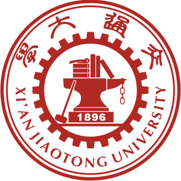
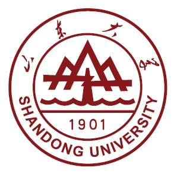

# MERCYAI

**M.S. Student · Applied Statistics · Xi'an Jiaotong University**

[GitHub](https://github.com/MERCYAI) · [Biography](#biography) · [Research](#research-interests) · [Education](#education)

## Biography

I am a master's student in **Applied Statistics** at [Xi'an Jiaotong University](https://www.xjtu.edu.cn/). Previously, I received my bachelor's degree in Mathematics and Applied Mathematics from [Shandong University](https://www.sdu.edu.cn/) in June 2026.

My research interests include **WAM**, **VLA**, and **AI Agent**. I explore how robots connect visual observations, language instructions, and action, with particular attention to closed-loop evaluation and robustness.

I enjoy tracing ideas from papers into code, understanding their training dynamics, and testing what holds up in interaction. When comparing methods, I look closely at the training data, checkpoints, task suites, and evaluation protocols behind the reported results.

## Research Interests

- **Vision–Language–Action & action generation.** Policy fine-tuning, action transformers, and Flow Matching for generating useful action sequences from multimodal inputs.
- **World models & JEPA.** Action-conditioned prediction and future latent representations, exploring how predictive representation learning can support robot policies.
- **Evaluation & robustness.** Closed-loop task performance on LIBERO, its robustness benchmarks, and RoboTwin, with attention to each benchmark's protocol.

## Education

<table>
  <tr>
    <td width="86" align="center" valign="middle"></td>
    <td valign="middle">
      <b>Xi'an Jiaotong University</b> 
      M.S. Student · Applied Statistics 
      2026.09 – Present · Expected graduation: June 2029
    </td>
  </tr>
  <tr>
    <td width="86" align="center" valign="middle"></td>
    <td valign="middle">
      <b>Shandong University</b> 
      Bachelor's Degree · Mathematics and Applied Mathematics 
      2022.09 – 2026.06
    </td>
  </tr>
</table>

## Research Approach

- **Read the implementation.** Follow the tensor shapes, data flow, objectives, and configuration behind a method.
- **Make comparisons explicit.** Check training data, checkpoints, task suites, trial counts, and inference settings before comparing scores.
- **Connect diagnostics to behavior.** Investigate a run through its training logs, then evaluate the policy through closed-loop task performance.

<b>中文介绍</b>

我目前在[西安交通大学](https://www.xjtu.edu.cn/)攻读**应用统计**硕士学位。此前，我于 2026 年 6 月获得[山东大学](https://www.sdu.edu.cn/)数学与应用数学学士学位。

我的研究兴趣包括 **WAM**、**VLA** 和 **AI Agent**。我探索机器人如何将视觉观测、语言指令与动作联系起来，尤其关注闭环评测与鲁棒性。

我喜欢把论文中的想法落实到代码中，理解其训练动态，并在实际交互中检验其有效性。比较不同方法时，我会仔细考察所报告结果背后的训练数据、检查点、任务集和评测协议。

