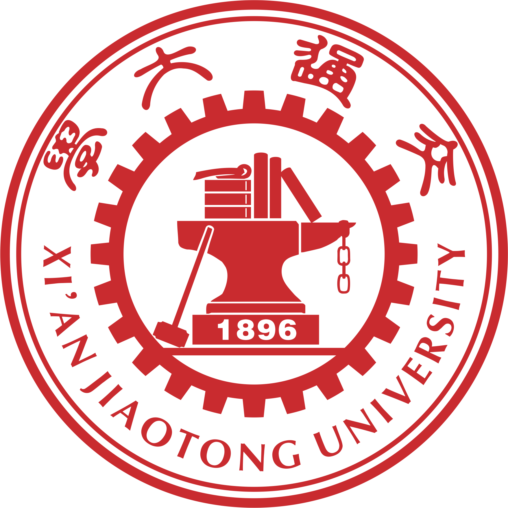

# Baqiao Deng

**M.S. Student · Applied Statistics · Xi'an Jiaotong University**

[GitHub](https://github.com/MERCYAI) · [Biography](#biography) · [News](#news) · [Publications](#publications) · [Internship](#internship) · [Education](#education)

## Biography

I am a master's student in **Applied Statistics** at [Xi'an Jiaotong University](https://www.xjtu.edu.cn/). Previously, I received my bachelor's degree in Mathematics and Applied Mathematics from [Shandong University](https://www.sdu.edu.cn/) in June 2026.

My research interests include **WAM**, **VLA**, and **AI agents**. In particular, I am interested in how world models can help robots anticipate the consequences of their actions and make better decisions.

## News

- **2026.11.18** — Our paper [ThinkWAM](https://arxiv.org/abs/2611.21258) is now available on arXiv, with a [project page](https://thinkwam-project.github.io/) and [code](https://github.com/HaoyunT/Thinkwam).

## Publications

**[ThinkWAM: Rethinking Latent Futures for Action Refinement](https://arxiv.org/abs/2611.21258)**

Haoyun Tang\*, **Baqiao Deng\***, Enjin Zhou, Songwen Tian, Keyao Xu, Bowen Jing, Kun Wang, Ke Ma, Zhandong Mei†, Huibin Li†

\* Equal contribution. † Co-corresponding authors. · arXiv preprint, 2026.

[arXiv](https://arxiv.org/abs/2611.21258) · [alphaXiv](https://www.alphaxiv.org/abs/2611.21258) · [Project](https://thinkwam-project.github.io/) · [Code](https://github.com/HaoyunT/Thinkwam)

A latent world-action model that rethinks predicted futures to refine robot actions.

## Internship

**[Fangju Research Institute](https://www.astrogrid.world/about)** | Embodied AI Research Intern

2026.09 – Present | Xi'an · On-site

## Education

<table>
  <tr>
    <td width="96" align="center" valign="top"></td>
    <td valign="middle">
      <b>Xi'an Jiaotong University</b> 
      M.S. Student · Applied Statistics 
      2026.09 – Present · Expected graduation: June 2029
    </td>
  </tr>
  <tr>
    <td width="96" align="center" valign="top"></td>
    <td valign="middle">
      <b>Shandong University</b> 
      Bachelor's Degree · Mathematics and Applied Mathematics 
      2022.09 – 2026.06
    </td>
  </tr>
</table>
