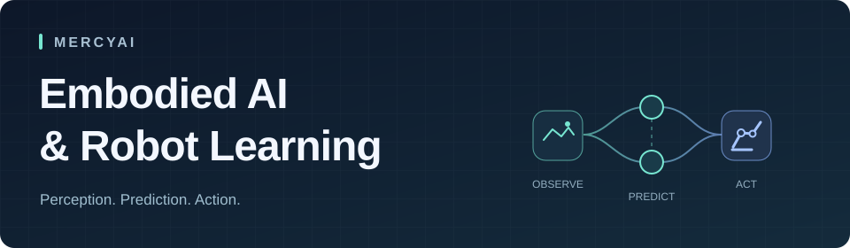

  

  <b>Vision–Language–Action · World Models · Robot Learning</b>

  <a href="https://github.com/MERCYAI?tab=repositories">Repositories</a> ·
  <a href="https://github.com/MERCYAI/FastWAM-22d">FastWAM experiments</a>

## About me

Hi, I'm **MERCYAI**. I work on embodied AI, exploring how robots connect visual observations, language instructions, and action.

My interests span **vision–language–action models**, **predictive world representations**, and **reliable robot policy evaluation**. I enjoy tracing ideas from papers into code, understanding the training dynamics, and testing what holds up in closed-loop interaction.

## Current interests

| Direction | Questions I explore |
| :--- | :--- |
| **VLA & action generation** | How can multimodal models produce useful action sequences? I explore policy fine-tuning, action transformers, and Flow Matching. |
| **World models & JEPA** | How can future latent representations help robot learning? I study action-conditioned prediction and representation learning. |
| **Evaluation & robustness** | How do policies behave across tasks and perturbations? I follow LIBERO, its robustness benchmarks, and RoboTwin, with attention to each evaluation protocol. |

## How I work

- **Read the implementation.** Follow the tensor shapes, data flow, objectives, and configuration behind a method.
- **Make comparisons explicit.** Check training data, checkpoints, task suites, trial counts, and inference settings before comparing scores.
- **Connect diagnostics to behavior.** Use training logs to investigate a run, then evaluate the policy through closed-loop task performance.

## Public code

### [FastWAM-22d](https://github.com/MERCYAI/FastWAM-22d)

An experiment workspace based on the FastWAM codebase, with training and evaluation workflows for LIBERO and RoboTwin.

## Working with

`Python` · `PyTorch` · `Linux` · `Distributed training` · `TensorBoard` · `Git`

<b>中文介绍</b>

我关注具身智能与机器人学习，主要探索视觉–语言–动作模型（VLA）、世界模型与未来潜在表征学习，以及机器人策略的闭环评测与鲁棒性。

我喜欢把论文中的方法落实到代码与实验中：梳理模型结构、数据流和训练目标，分析训练过程，再通过任务表现检验效果。比较不同方法时，我尤其关注训练数据、具体检查点、任务范围与评测协议是否一致。

近期关注的主题包括 JEPA、动作 Transformer、Flow Matching，以及 LIBERO 系列和 RoboTwin 上的策略评测。

---

<i>From paper to code. From prediction to action.</i>

